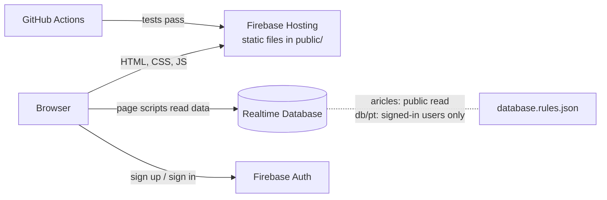
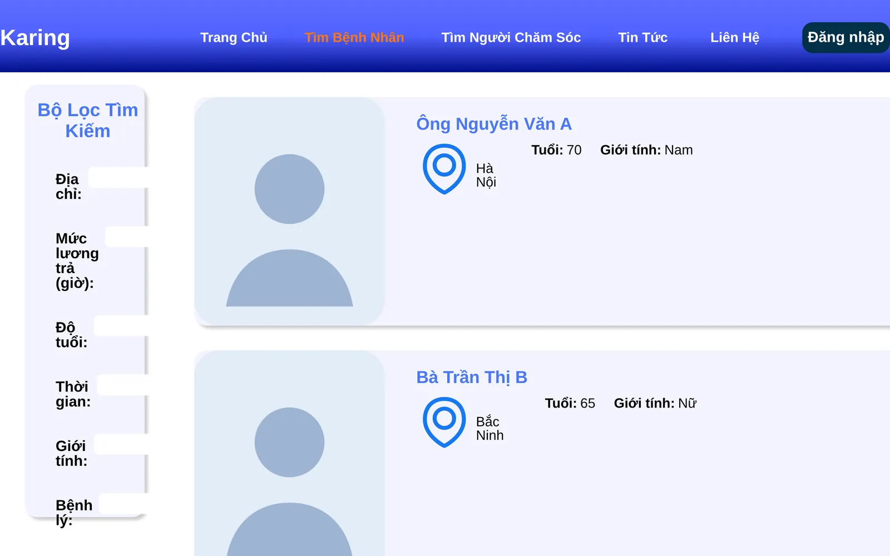
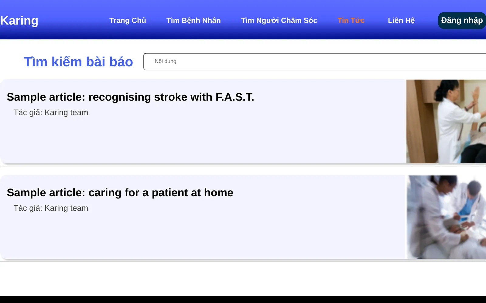

# Karing

**A web platform that connects families of stroke patients in Vietnam with qualified in-home caregivers.**

[](https://github.com/EliteVanor/Karing-Webapp/actions/workflows/firebase-hosting-merge.yml)
&nbsp;Live site: [karing-a8b53.web.app](https://karing-a8b53.web.app/) (lists stay empty until the new database rules are deployed) &nbsp;·&nbsp; Built 2023 · Revised 2026 &nbsp;·&nbsp; [Tóm tắt tiếng Việt](#tóm-tắt-tiếng-việt)


## The problem

Vietnam has about 200,000 new stroke cases a year (World Stroke Organization figures for 2022). Hospital capacity is limited and hospital stays are expensive, so many patients go home before they have recovered. Their families then become the caregivers, usually without the skills or the time that early stroke care needs.

Families can hire nurses and therapists who specialize in stroke care, but in 2022 there was no marketplace for this service in Vietnam. Families and caregivers found each other by word of mouth, so families had few options and little information to judge a caregiver. Caregivers, in turn, had no reliable way to reach the families who needed them.

Karing puts both sides in one place: a verified directory of stroke-care professionals, patient profiles that tell caregivers what is needed, and practical information about stroke for families.

## Research

We worked with 5 healthcare institutions, including the stroke departments of Bach Mai Hospital, Hanoi Medical University Hospital, 103 Hospital and Central Acupuncture Hospital. Through them we interviewed 36 family members of stroke patients, and we also interviewed 24 nurses and technicians who care for stroke patients.

| What we heard | How it shaped Karing |
|---|---|
| Both sides found each other only by word of mouth | A searchable directory of caregivers and of patients who need care |
| Families named 11 things they need to know before hiring: name, sex, age, hometown, phone, qualifications, experience, working hours, rate, personality, and reviews from earlier families | These became the fields of a caregiver profile |
| Caregivers need to know the patient's condition, the address, the family's budget and the schedule | These became the fields of a patient profile |
| Every caregiver was willing to share their details, but some did not want them public while the platform was in beta | Caregiver details are checked by an admin before they are published, and (since 2026) patient data is visible only to signed-in users |
| We asked both sides how much they would pay to keep the platform running | A planned fee of 100,000 VND per successful connection, split between the family and the caregiver |

## What we built (2023)

- **Patient and caregiver listings** so each side can find the other.
- **Stroke information**: what a stroke is, its causes, how to recognize it (F.A.S.T.), diagnosis and prevention.
- **News and articles** about stroke care, served from the database.
- **Accounts** with email and password sign-up and sign-in.

**Results**

- Launched with a starting database of 28 verified stroke-care professionals.
- Connected 60+ stroke patient families with caregivers.
- 3rd place, SV.Startup V Vietnam National Competition.
- Paper: Bui, D. K. (2023). *A Web-Based Solution to Caring for Stroke Patients at Home in Vietnam.* 17th NEU-KKU International Conference on Socio-Economic and Environmental Issues in Development.
- In March 2023, Ô Xanh Internet Technology JSC committed in writing to invest in the project and run it as part of the company. Ownership was transferred to them for continued development.

## My role

I founded Karing as a grade-11 computer science student at Hanoi-Amsterdam High School and led it as CTO of a 7-member team. I ran the field research, turned it into requirements and design decisions, and wrote most of the front-end code (HTML, CSS and JavaScript on Firebase).

The code was first built in a separate team repository and later moved into this one from a teammate's account, so the commit history here does not show who wrote what.

In 2026 I came back to the code on my own and revised it. That work is described [below](#2026-revision-what-i-changed-and-why).

## How it works



In words:

1. Firebase Hosting serves plain static pages from `public/`. There is no build step.
2. Each page loads two ES modules: `js/layout.js` draws the shared navigation and footer, and one page script in `js/pages/` describes how to render that page's data. `js/view.js` does the loading, error and sign-in handling for all of them.
3. Page scripts read articles and patient profiles from the Realtime Database. `database.rules.json` makes articles public and patient profiles readable only by signed-in users.
4. Firebase Authentication handles email and password accounts.
5. GitHub Actions runs the tests on every pull request and on `main`. A deploy happens only when the tests pass.

## 2026 revision: what I changed and why

The original 2023 code is kept under the tag [`v1-2023`](https://github.com/EliteVanor/Karing-Webapp/tree/v1-2023) for comparison. I kept the visual design the same and changed the engineering underneath. Every change has a test, or a pixel comparison of every page against screenshots of the original.

| Problem in the 2023 code | What I changed | How I checked it |
|---|---|---|
| Every page loaded one `main.js` that ran every database query, so pages crashed on data that was not theirs | One small module per page, plus shared `firebase.js`, `auth.js`, `dom.js`, `format.js` and `view.js` (loading, errors and sign-in handling in one place) | No JS errors on any page (e2e test) |
| Database text was inserted as raw HTML, so a stored record could run scripts (XSS) | All database content is rendered as text through one helper. Image URLs must be `http(s)` | Tests feed hostile records and check that nothing runs |
| The database rules were in test mode and expired in June 2026. Anyone could read and write while they were active | `database.rules.json`: no client writes, public articles, patient data for signed-in users only | Tests cover signed-out, signed-in and permission-denied states |
| The 110-line nav and the footer were copied into 8 pages, and the copies had drifted (a typo in one footer email, a wrong active link) | One nav and footer template in `layout.js` | Pixel diff against the original pages |
| About 2,800 lines of CSS across 5 files, most of the rules copied between them | `base.css` for shared rules, one small file per page type | Pixel diff: identical apart from the intended fixes |
| The fixed nav was wider than a 1280px laptop screen, so the Contact and Login buttons could not be reached | The nav shrinks to the screen width | e2e test clicks both buttons at 1280px |
| The age row overlapped the patient name and swallowed clicks on it | The link sits above the overlap | Regression test, confirmed to fail on the old CSS |
| The login popup was a mock-up, sign-up and sign-in pages were unstyled, and links pointed to a missing `login.html` | Working login popup (loads Firebase only when used), styled pages, Vietnamese error messages, redirects for old URLs | e2e tests of sign-in, sign-out and sign-up |
| `facebook.png` was linked with the wrong letter case, so it was missing on the live (case-sensitive) server | Lower-case kebab-case file names | No 404s on any page (e2e test) |
| 2.7 MB of images, half of them unused | Unused files deleted, photos converted to WebP | Image folder is now about 360 KB |
| CI ran `npm run build`, which did not exist, so every run failed | CI installs, runs unit and e2e tests, then deploys | YAML validated locally. The first real run is the next push |

## What I would do differently today

- **Security rules on day one.** Test-mode rules are a start-up shortcut that quietly expires and leaves data open while it lasts.
- **Mobile first.** Families mostly use phones, and the 2023 layout is fixed-width. A responsive layout is the next piece of work.
- **Real access control for health data.** Signed-in-only is better than public, but any account can still sign up. Patient data needs roles (family, caregiver, admin) and consent records.
- **A data model before pages.** The database key `aricles` (sic) still carries a typo, because renaming it needs a data migration.
- **Tests from the start.** The stub-based e2e tests in `tests/` found two bugs that had been live since 2023: the unreachable nav buttons and the unclickable patient names.

## Screenshots

| Patients and caregivers on the home page | Stroke information |
|---|---|
|  |  |
| **Patient listing (sample data)** | **News** |
|  |  |

Photos and names of real people are blurred. The patient listing shows made-up sample records.

## Project structure

```
public/                 Everything Firebase Hosting serves
  *.html                One file per page (home, info, listings, news, detail, auth, 404)
  css/
    base.css            Shared: reset, nav, modals, footer
    home.css, info.css, listing.css, news.css, auth.css
  js/
    layout.js           Shared nav, contact and login modals, footer
    firebase.js         Firebase setup and database paths (the only file that knows the project)
    auth.js             Sign in, sign up, sign out, auth state
    dom.js              Safe element builder and small DOM helpers
    format.js           Pure helpers (names, error messages, URL and key checks), unit tested
    view.js             Binds a page element to a database path: loading, empty, error, sign-in
    pages/              One script per page that needs data or behavior
  images/
tests/
  unit/                 node:test tests for format.js
  e2e/                  Playwright tests for every page, desktop and mobile
  support/              Firebase stub, sample data, offline page server
database.rules.json     Realtime Database security rules
firebase.json           Hosting config, redirects for old URLs, cache headers
.github/workflows/      Test, then deploy (main) or preview (pull requests)
```

## Run it locally

You need Node.js 20 or newer.

```bash
npm install
npm start
```

Then open http://localhost:5000. The local site talks to the real Firebase project, so lists stay empty unless the database rules allow the read.

## Tests

```bash
npx playwright install chromium
npm test
```

`npm test` runs the unit tests (`node --test`) and the Playwright tests. The Playwright tests need no network. They serve `public/` from disk and replace the Firebase SDK with a stub (`tests/support/firebase-stub.js`) that returns made-up data, so they can test empty, error and hostile-data cases that the real database cannot produce on demand.

## Deploy

- **Hosting** deploys automatically from `main` after the tests pass. Pull requests from this repository get a preview channel.
- **Database rules** do not deploy automatically. After a change to `database.rules.json`, run:

```bash
npx firebase-tools deploy --only database --project karing-a8b53
```

## Known limitations

- The layout is fixed-width from the 2023 design, so phones show a zoomed-out page. The Playwright interaction tests run on desktop only for this reason.
- Search forms, filters, the newsletter box and the caregiver listing are static mock-ups from the 2023 prototype.
- Any visitor can create an account, and every account can read patient profiles. See "What I would do differently today".

## Team and credits

Founded by Bui Duc Khoi and built in 2023 by a 7-member team in Hanoi. In 2023, ownership was transferred to Ô Xanh Internet Technology JSC for continued development.

## Tóm tắt tiếng Việt

**Karing** là nền tảng web kết nối gia đình có người bệnh đột quỵ với người chăm sóc tại nhà có chuyên môn. Dự án do Bùi Đức Khôi sáng lập và dẫn dắt khi đang học lớp 11 chuyên Tin, Trường THPT Chuyên Hà Nội - Amsterdam, cùng nhóm 7 thành viên, dựa trên nghiên cứu cùng 5 cơ sở y tế, phỏng vấn 36 người nhà bệnh nhân và 24 người có chuyên môn chăm sóc. Karing ra mắt với cơ sở dữ liệu ban đầu gồm 28 người chăm sóc đã được xác minh, đã kết nối hơn 60 gia đình, đạt giải Ba cuộc thi SV.Startup V toàn quốc và được Công ty Cổ phần Công nghệ Internet Ô Xanh cam kết đầu tư, tiếp nhận phát triển.

Năm 2026, mã nguồn được viết lại phần kỹ thuật nhưng giữ nguyên giao diện: tách mã theo từng trang, chống chèn mã độc (XSS) từ cơ sở dữ liệu, thêm quy tắc bảo mật cho dữ liệu bệnh nhân, sửa lỗi điều hướng và đăng nhập, giảm dung lượng ảnh từ 2,7 MB xuống khoảng 360 KB, và thêm kiểm thử tự động chạy trên GitHub Actions. Mã gốc năm 2023 được giữ tại tag `v1-2023`.
